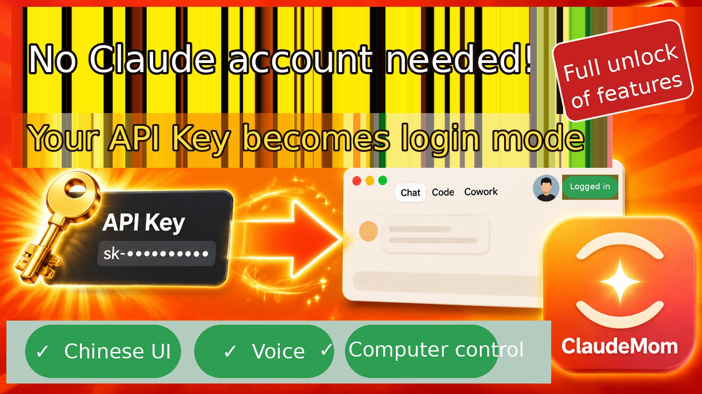
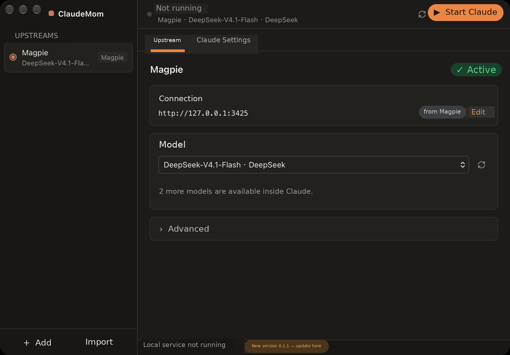
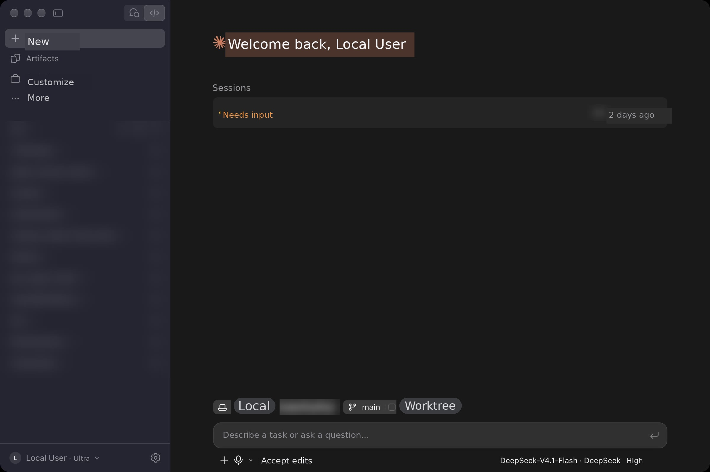

# ClaudeMom

**[English](README.md) · [简体中文](README.zh-CN.md) · [Русский](README.ru.md)**

**No Claude account needed! Turn your API Key into login mode and unlock the full Claude Desktop feature set (Chinese UI / voice input / computer control)**



Claude Desktop has always had two ways to run:

- **Sign in with an official account**: full features — Chat / Code / Cowork, computer control, voice input
- **Enter an API Key (third-party / 3p mode)**: works, but many feature entry points simply disappear

ClaudeMom is a **new way in**: it turns your API Key into **login mode** on your own machine. Claude Desktop sees a signed-in account — the interface and features are the logged-in ones — while the actual model requests go to your own Base URL + Key.

No Claude account required. The original app is never modified, the official login state is never touched, and the official app keeps updating as usual.

Download: [Releases](https://github.com/BigPizzaV3/ClaudeMom/releases/latest) (macOS universal dmg / Windows exe)

Friendly link: <a href="https://linux.do">LINUX DO</a>

## Comparison of the three ways in

| | Official account login | API Key (3p mode) | **ClaudeMom** |
|---|---|---|---|
| Claude account required | Yes | No | **No** |
| Model source | Official | Your Key | **Your Key** |
| Chat / Code / Cowork | ✅ | Partial | **✅** |
| Computer control / voice input | ✅ | ❌ | **✅** |
| Chinese interface | ✅ but risky to enable | ❌ | **✅** |

## How it works

A local compatibility service takes over the account and feature requests of Claude Desktop: account information and feature flags are returned as "logged in", while conversation requests are forwarded to the upstream you configured. The certificate is only valid on your machine and can be untrusted at any time.

## Features

- **Login-mode experience**: Chat / Code / Cowork tabs all work — it is the original client, not a web wrapper
- **Multiple upstreams**: each group is one Base URL + Key (Anthropic-compatible, same semantics as `ANTHROPIC_BASE_URL`), switch anytime, fetch model lists
- **One-click import**: Claude providers from cc-switch; you can also use Magpie's local gateway as an upstream
- **Chinese interface**: full Chinese UI
- **Voice input**: local offline dictation (SenseVoice) — audio never leaves your machine
- **Computer control / background mode**: on newer macOS, Claude shows "background mode not supported yet"; there is a switch in Advanced to lift the version restriction (off by default)
- **Code tab shares `~/.claude` with the CLI**: Claude Code sessions created in the terminal and other tools also appear in the Desktop sidebar
- **Auto-update**; the macOS build is signed + notarized — download and open





## Getting started

1. Install the official Claude Desktop and Node.js 22+
2. Open ClaudeMom and trust the local certificate when prompted (valid on this machine only)
3. Add an upstream (or import from cc-switch) and pick a default model
4. Click "Start Claude" — you are in the logged-in interface

Issues and PRs are welcome — let's make Claude Desktop more comfortable together!

## Repository layout

| Directory | Purpose |
|---|---|
| `crates/claude-local` | Core: local compatibility service (`runtime/`), certificates, profile switching, start / stop, dictation. |
| `apps/claude-mom` | ClaudeMom desktop app (Tauri + React). |

## Development

```bash
cd apps/claude-mom
npm install
npm run check && npm test          # frontend
cargo test --workspace             # Rust (from the repository root)
npx tauri build --bundles app      # build the macOS .app
node scripts/relaunch-local.mjs    # rebuild and restart the local instance (from the repository root)
```

Node tests for the core: `cd crates/claude-local/runtime && node --test managed.test.mjs proxy.test.mjs`
(a local test certificate is required: `scripts/gen-ca.sh`).

## License

AGPL-3.0-only
