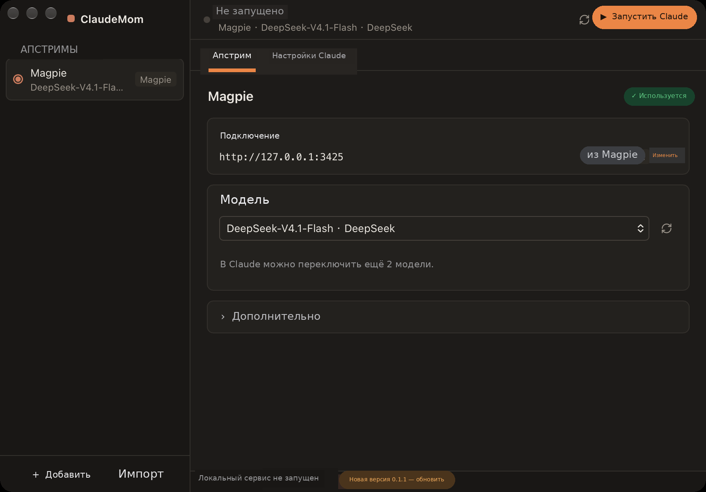
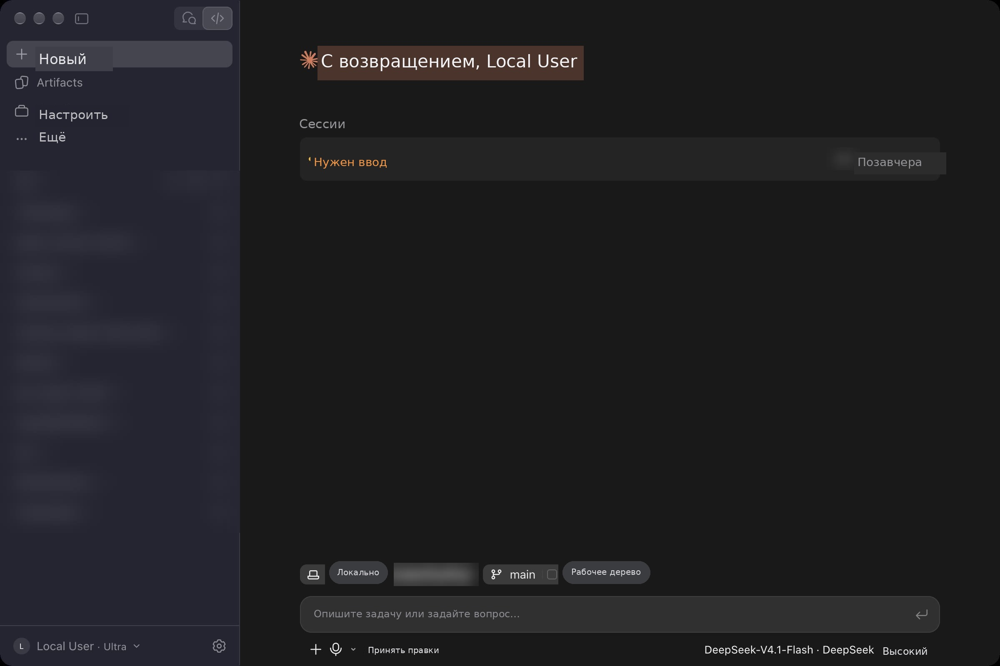

# ClaudeMom

**[English](README.md) · [简体中文](README.zh-CN.md) · [Русский](README.ru.md)**

**Без аккаунта Claude! Ваш API Key превращается в режим входа — и десктоп Claude открывает все функции (китайский интерфейс / голосовой ввод / управление компьютером)**


У десктопа Claude всегда было два способа работы:

- **Войти в официальный аккаунт**: все функции — Chat / Code / Cowork, управление компьютером, голосовой ввод
- **Вписать API Key (сторонний / 3p-режим)**: работает, но многие функции просто исчезают из интерфейса

ClaudeMom — **третий способ**: он превращает ваш API Key в **режим входа** прямо на вашей машине. Десктоп Claude видит вошедший аккаунт — интерфейс и функции как у входа через логин, — а реальные запросы к модели уходят на ваш Base URL + Key.

Аккаунт Claude не нужен. Оригинальное приложение не меняется, официальный вход не трогается, официальный App обновляется как обычно.

Скачать: [Releases](https://github.com/BigPizzaV3/ClaudeMom/releases/latest) (универсальный dmg для macOS / exe для Windows)

Дружеская ссылка: <a href="https://linux.do">LINUX DO</a>

## Сравнение трёх способов подключения

| | Вход в официальный аккаунт | API Key (3p-режим) | **ClaudeMom** |
|---|---|---|---|
| Нужен аккаунт Claude | Да | Нет | **Нет** |
| Откуда модель | Официальная | Ваш Key | **Ваш Key** |
| Chat / Code / Cowork | ✅ | Частично | **✅** |
| Управление компьютером / голосовой ввод | ✅ | ❌ | **✅** |
| Китайский интерфейс | ✅, но включать страшновато | ❌ | **✅** |

## Как это устроено

На вашей машине поднимается локальный сервис совместимости, который принимает на себя запросы аккаунта и функций десктопа Claude: сведения об аккаунте и переключатели функций возвращаются как «выполнен вход», а диалоговые запросы уходят на настроенный вами апстрим. Сертификат действует только на этой машине, доверие к нему можно отозвать в любой момент.

## Возможности

- **Опыт режима входа**: работают все три вкладки — Chat / Code / Cowork; это оригинальный клиент, а не веб-обёртка
- **Несколько апстримов**: в каждой группе свой Base URL + Key (совместимо с Anthropic, смысл тот же, что у `ANTHROPIC_BASE_URL`), переключение на лету, список моделей подтягивается
- **Импорт в один клик**: провайдеры Claude из cc-switch; локальный шлюз Magpie тоже можно назначить апстримом
- **Китайский интерфейс**: полный перевод UI на китайский
- **Голосовой ввод**: локальная офлайн-диктовка (SenseVoice) — звук не покидает вашу машину
- **Управление компьютером / фоновый режим**: на свежих macOS Claude пишет «фоновый режим пока не поддерживается»; в разделе «Дополнительно» есть переключатель, снимающий ограничение по версии системы (по умолчанию выключен)
- **Вкладка Code делит `~/.claude` с командной строкой**: сессии Claude Code, созданные в терминале и других инструментах, видны и в боковом списке десктопа
- **Автообновление**; сборка для macOS подписана и нотаризована — скачал и открыл





## Начало работы

1. Установите официальный Claude Desktop и Node.js 22+
2. Откройте ClaudeMom и при первом запуске доверитесь локальному сертификату (действует только на этой машине)
3. Добавьте апстрим (или импортируйте из cc-switch) и выберите модель по умолчанию
4. Нажмите «Запустить Claude» — откроется интерфейс как у вошедшего пользователя

Issues и PR приветствуются — сделаем десктоп Claude удобнее вместе!

## Структура репозитория

| Каталог | Назначение |
|---|---|
| `crates/claude-local` | Ядро: локальный сервис совместимости (`runtime/`), сертификаты, переключение профилей, запуск / остановка, диктовка. |
| `apps/claude-mom` | Десктоп-приложение ClaudeMom (Tauri + React). |

## Разработка

```bash
cd apps/claude-mom
npm install
npm run check && npm test          # фронтенд
cargo test --workspace             # Rust (из корня репозитория)
npx tauri build --bundles app      # собрать macOS .app
node scripts/relaunch-local.mjs    # пересобрать и перезапустить локальный экземпляр (из корня репозитория)
```

Node-тесты ядра: `cd crates/claude-local/runtime && node --test managed.test.mjs proxy.test.mjs`
(нужен локальный тестовый сертификат: `scripts/gen-ca.sh`).

## Лицензия

AGPL-3.0-only
