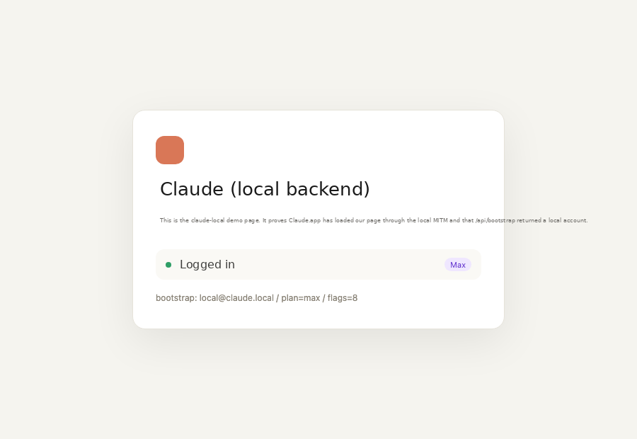
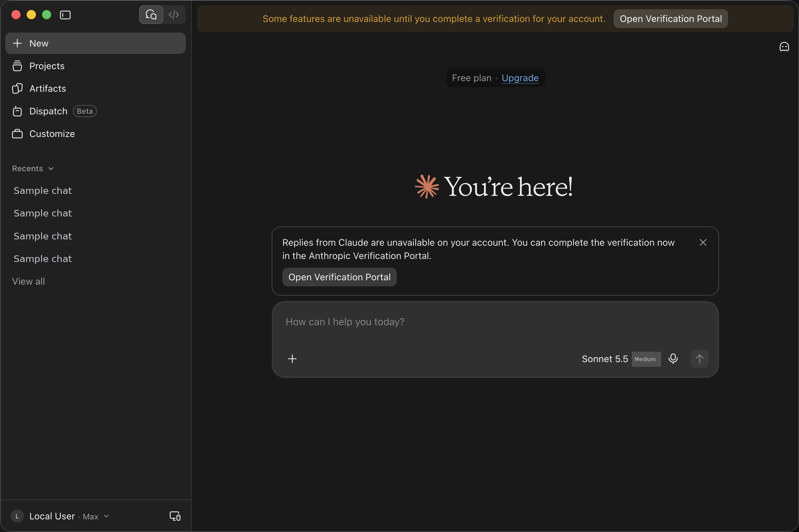

# claude-local: local compatibility backend for Claude Desktop (PoC)

**[English](README.md) · [简体中文](README.zh-CN.md) · [Русский](README.ru.md)**

## Codex++ managed runtime

Managed mode uses the original Claude Desktop connected to the local service via
`--proxy-server`; no Claude installer is built or rewritten. Proxy, certificates, cache and
session data are managed by Codex++ in a separate state directory; a regular original
launch does not automatically get this proxy connection.

`CLAUDE_LOCAL_MANAGED=1` enables the managed protocol. At runtime it needs only the tracked
Node modules and the Chinese localization catalog; it does not read the repository's `mock/`,
locally recorded bootstraps, recorded catalogs or `vendor/`. Web static assets are still
served by the original client and a reachable upstream; synthesized API data contains no
private access values of dynamic resources. Managed mode serves the official SPA read-only
from the current installer; with localization enabled, a same-origin `page-shim.js` is
injected only into the proxied HTML before the first official script runs, guiding the
official frontend to the Chinese catalog — Claude.app itself is never rewritten.

| Environment variable | Purpose |
| --- | --- |
| `CLAUDE_LOCAL_GATEWAY_URL` / `_KEY` / `_MODEL` | Codex++ gateway root URL, local credentials and default model; required in managed mode |
| `CLAUDE_LOCAL_GATEWAY_MODELS` | JSON string array listing selectable provider/model IDs |
| `CLAUDE_LOCAL_GATEWAY_SMALL_MODEL` | model for lightweight tasks; falls back to the default model |
| `CLAUDE_LOCAL_GATEWAY_MODEL_WINDOWS` | JSON object with per-model context windows (`{"provider/model": 1100000}`); keys also accept bare model names |
| `CLAUDE_LOCAL_GATEWAY_DEFAULT_WINDOW` | window shown by the UI / used by the CLI when the selected model has no per-model entry; without it Claude's own 200k assumption applies |
| `CLAUDE_LOCAL_WEB_I18N_DIR` | full Chinese localization catalog shipped with the app |
| `CLAUDE_LOCAL_CACHE_DIR` | local proxy cache; dictation patches are also written here |
| `CLAUDE_LOCAL_STATE_FILE` | session and notification settings file; written atomically, mode `0600` |
| `CLAUDE_LOCAL_READY_FILE` / `_INSTANCE_ID` | ready receipt and instance identity of the current launch |
| `CLAUDE_LOCAL_LOCALIZATION` / `_VOICE_INPUT` / `_COMPUTER_USE` / `_BACKGROUND_MODE` / `_FORCE_BACKGROUND_MODE` | independent toggles per capability, `0` off, `1` on; the last one ignores the macOS version cap on background mode |
| `CLAUDE_LOCAL_COWORK` | master switch for Cowork (GrowthBook `yukon_silver`), on by default; at `0` Claude's own value from the recorded template is used |

Managed launch supports `--port 0`: after binding it writes a
`{instanceId,pid,port,mode,lastClientAt}` receipt — no gateway credentials inside.
`GET /__codex_claude_local/health` returns the same identity plus the last client connect
time; health polling itself does not update that time. Direct HTTP model requests require
local gateway credentials and reject browser `Origin` requests; the HTTPS link of the
original client is still handled by the local service.

The model picker's synthetic configuration comes from the available model list; RPC
`SendMessage.model` and `SetConversationModel` preserve the actual choice; multi-turn chats
send the completed history to the gateway. An unknown native default model maps to the
configured default model; the fixed Haiku lightweight model maps to the lightweight config.
After a proxy restart, sessions and notification preferences are restored and interrupted
replies are marked as finished — nothing is auto-resent. On stdin EOF or `SIGTERM` the
managed process saves state and closes the listener.

Managed contract tests:

```bash
node --test tools/claude-local/managed.test.mjs
```

Goal: **no account, models go through your own API, but the client is fully functional.**

The approach is not to fake a session, but to **act as the server yourself**:

```
Claude.app ──► local CA + MITM(8899) ──► static assets pass through to claude.ai (real UI)
                                        ├─ /api/*, /edge-api/* taken over by local mocks
                                        └─ /claudeai-rpc/* ConversationService
                                             └─ PerformAction(send_message) → record conversation
                                                StreamTimeline → update/append frames
                                                └─ reply text ← local model gateway SSE
```



> The image above is Chromium (the same engine as Electron) rendering `https://claude.ai/`
> through the local proxy: CONNECT → TLS termination → `/api/bootstrap` returns a local
> account → the page shows "Logged in · Max".

## Current state (tested)

| Capability | Status | How verified |
| --- | --- | --- |
| Local CA + server certificate | ✅ | `scripts/gen-ca.sh` |
| CONNECT + TLS termination (SNI) | ✅ | `scripts/test.sh` |
| `/api/bootstrap` fake account (plan=max) | ✅ | `curl --proxy + --cacert` returns JSON |
| `/api/organizations`, conversation list/create | ✅ | same |
| Real Claude.app shows Local User · Max | ✅ | tested UI + `demo/en/app-loggedin.png` |
| `PerformAction` send_message → MutationAck | ✅ | tested, no retries, message appears |
| `StreamTimeline` update→append→complete | ✅ | tested streaming render (markdown) |
| Replies wired to local gateway (Anthropic Messages SSE) | ✅ | magpie @127.0.0.1:3425 tested |
| New conversation / follow-up in old conversation | ✅ | both paths tested |
| Demo page (verifies Claude can load our page) | ✅ | `/` returns the demo page |
| Installing the CA into the keychain | ⚠️ one manual approval click | `scripts/install-ca.sh` |

### This network cannot reach claude.ai

```
direct claude.ai            → 302 /app-unavailable-in-region (region block)
via Clash(7897) claude.ai   → 403 Cloudflare challenge
real Chrome opening claude.ai → Cloudflare human-verification page
```

So `mock` mode cannot fetch real frontend assets (Claude itself is in the same state on this
machine). **On a machine that can open claude.ai normally, simply running `--mode mock`
yields "real UI + local account".**

## Quick start

```bash
cd tools/claude-local

# 1) generate the local CA
sh scripts/gen-ca.sh

# 2) install it into the keychain (one system approval dialog — click Allow)
sh scripts/install-ca.sh

# 3) self-check (no Claude needed, no internet either)
sh scripts/test.sh

# 4) run the demo: Claude loads the local demo page and shows Max
sh scripts/run.sh demo

# 5) on a network that can reach claude.ai, run the real UI + mocked /api
sh scripts/run.sh mock
```

Claude launch flag: `--proxy-server=http://127.0.0.1:8899`.

## Directory layout

```
ca/                 local CA and server certificates (do not commit)
mock/bootstrap.json locally recorded account template (do not commit; may contain resource credentials)
mock/api/conversations.json  locally recorded history template (do not commit)
demo/index.html     demo page (proves the pipeline)
proxy.mjs           CONNECT + TLS + mock + upstream forwarding + routing
rpc.mjs             protobuf wire / Connect frames / message builders
conversation-service.mjs  ConversationService: StreamTimeline / PerformAction / fallbacks
scripts/gen-ca.sh   generate certificates
scripts/install-ca.sh / uninstall-ca.sh
scripts/run.sh      start proxy + launch Claude
scripts/test.sh     end-to-end self-check
.cache/             upstream static asset cache (written during passthrough)
```

On startup in mock mode, the dictation client of a pinned version is read from Claude's
local Electron cache, and the plain dictation drain baseline of the local copy is extended
to 125 seconds; the `thinkAloud` branch stays at 60 seconds. The patch writes only into
`.cache/` in this directory and never modifies Claude's app cache; on version mismatch it
refuses to start. Restore the local copy:

```bash
node scripts/patch-dictation-drain.mjs --restore
node scripts/patch-dictation-start.mjs --restore
```

The dictation start patch of the same pinned version limits dynamic module loading to 15
seconds, native startup to 20 seconds, and `AudioContext.resume()` to 5 seconds. A timeout
cancels the current start and releases the audio context; a late microphone stream is
released via the native generation check, and the UI returns to a retryable state. The patch
is only served from the local proxy in mock mode; neither the installer nor system
microphone permissions are touched. `[Claude Local Dictation]` and
`window.__codexPlusLocalDictationStatus` in the developer console log only the
pending / connecting / recording / finishing / idle / error stages and status booleans — no
transcripts, audio, or session identifiers.

Local WebSocket dictation triggers one real interim transcription after 4 seconds of audio
accumulate in the current speech-bearing segment, and refreshes it every further 4 seconds
of continuous speech; the segment text is committed on a 600 ms pause or when the segment
reaches 12 seconds. `CloseStream` drains received audio; pure silence triggers no
recognition and produces no text. Each WebSocket session is capped at 16 minutes or a
cumulative 25 MiB of audio, whichever comes first.

The default request timeout of the generic HTTP transcription endpoint remains 120 seconds;
this does not mean WebSocket dictation waits for recording to finish before recognizing.
An HTTP request timing out returns an error first; the client's drain wait neither extends
nor retries that request. Mock-mode launch uses `--disable-http-cache` so the client reads
this copy from the local proxy; passthrough and demo do not apply the patch. The launch
scripts align `CODEX_PLUS_STATE_DIR` with the current manager instance: an explicit
environment variable wins, then the `dist/local-build/state` belonging to the repository's
`dist/local-build/Codex++.app`, and finally the fallback `$HOME/.codex-session-delete`.

The source contains no locally recorded accounts, session templates, or static caches;
when recordings are missing, the proxy uses built-in placeholder data. The real-UI
verification in this document is based on local recordings; full UI compatibility still
depends on local API data and static assets.

## Which endpoints are mocked

```
GET  /api/bootstrap
GET  /api/account
GET  /api/organizations
GET  /api/organizations/:org
GET/POST /api/organizations/:org/chat_conversations
GET  /api/organizations/:org/chat_conversations_v2   (static template + runtime conversation merge)
GET  /api/organizations/:org/chat_conversations/:uuid
POST /api/organizations/:org/chat_conversations/:uuid/completion   (SSE, legacy path, no longer used by Desktop)
GET  .../usage | /limits
POST /claudeai-rpc/anthropic.bard.api.v1alpha.ConversationService/*  (Connect RPC, main path)
```

Field values are placeholders shaped after the public frontend code. **On a machine with
access to claude.ai, run `--mode passthrough` first to capture real responses**, then align
field by field (the same routine used to calibrate Codex stubs with `capture-account.mjs`).

## Rollback

```bash
sh scripts/uninstall-ca.sh   # remove the CA
# quit Claude and open it normally (no more --proxy-server)
```

## Boundaries

- No account forgery: Claude's identity lives on the server; the client has no anchor to forge.
- Claude.app untouched: only a CA is installed + a proxy flag; updates keep working.
- `/completion` requires converting third-party model output into claude.ai's SSE event
  sequence (skeleton in place; wiring the gateway is the next step).
- Feature completeness depends on mock coverage; Computer Use needs protocol verification
  of frontend + local bridge and is not covered yet.

## Next steps

1. Conversation persistence: persist CONV_STATE to disk (JSON) so history survives restarts;
2. Multimodal / tool calls: schemas for attachments, client_tools, elicitation are already
   in the descriptor — fill in as needed;
3. Gateway-side context: currently only the latest prompt is sent per turn; later, stitch
   conv.turns into a messages history;
4. Verify the Computer Use / Cowork pipeline separately.

---

## 2026-11-07 field-test correction (important)

After launching local Claude 4.16336.0 with `--proxy-server`, what was actually observed:

- the window is still the **locally rendered** Cowork / Code UI; there is no `GET /` request;
- only endpoints like `POST /api/event_logging/v2/batch` and `POST /api/v2/rum` hit the proxy;
- that is: **this Claude Desktop build's main UI is not the claude.ai web page**;
  `claude.ai` only serves part of the API and telemetry.

Corrected conclusions:

| Previous assumption | Measured |
| --- | --- |
| Desktop main UI = claude.ai remote web page | ❌ locally rendered |
| The real UI must be mirrored for it to work | ❌ not needed |
| A fake `/api/bootstrap` makes the UI show Max | ❌ the local UI does not take the account from bootstrap |

So this tool's value narrows to:

- ✅ proving the "local CA + MITM + fake API" pipeline works (verified);
- ✅ direct reuse if the claude.ai web surface is ever needed;
- ❌ it cannot unlock account-gated features of the local UI that are decided server-side
  (Computer Use, Cowork, etc.).

The account state of the local UI is determined by the app's own storage
(`~/Library/Application Support/Claude-3p/`) and server-side APIs — not by claude.ai HTML.

---

## 2026-11-07 milestone: the real Claude.app now "believes" it is logged in



Configuration:

- `~/Library/Application Support/Claude-3p/claude_desktop_config.json` → `deploymentMode: "1p"`
- move `configLibrary/` away (otherwise the app goes through gateway onboarding)
- launch: `open -a Claude --args --proxy-server=http://127.0.0.1:8899`
- proxy: `node proxy.mjs --mode mock`

Result: the real Claude Desktop renders the full chat interface, shows **Local User · Max**
in the bottom-left corner, and Projects / Artifacts / Dispatch / Customize all appear.

Data sources:

- shell HTML: recorded from a real browser by `capture.mjs`
- account structure: after logging into a real account, `/edge-api/bootstrap` was captured
  and scrubbed into `mock/bootstrap.json`
- endpoint shapes: `mock/api/*.json` (conversations / account_profile / skills / experiences, etc.)

### Restoring gateway mode

```bash
cd ~/Library/Application\ Support/Claude-3p
python3 - <<'PY'
import json; p='claude_desktop_config.json'; d=json.load(open(p)); d['deploymentMode']='3p'; json.dump(d,open(p,'w'),ensure_ascii=False,indent=2)
PY
mv /tmp/claude-configLibrary-live2 configLibrary   # if you moved it away earlier
```

---

## Chat replies: Connect + protobuf (working)

Measured: the client's replies do not use the JSON `/completion`; they use Connect RPC over
HTTP/1.1 chunked:

```
POST /claudeai-rpc/anthropic.bard.api.v1alpha.ConversationService/<Method>
Content-Type: application/connect+proto   (server-streaming)
Content-Type: application/proto           (unary)
```

Frame format: `[1B flag][4B big-endian length][protobuf]`; flag 0x02 = end frame (payload is
JSON trailers).

The implementation has two layers:

- `rpc.mjs` — hand-written protobuf wire codec (no runtime dependency) + Connect frames +
  all message builders in use
- `conversation-service.mjs` — `ConversationService` dispatch: `StreamTimeline`
  (long-lived), `PerformAction` (send_message / stop_generation), `SendAndSettle`,
  `ReadConversation`, `ListConversations`, `StreamConversationList`,
  `GetNewConversationDefaults` and other fallbacks

### Reply pipeline

```
PerformAction(send_message)                StreamTimeline (long-lived)
  ├─ parse ActionHeader.mutation_id          ├─ first frame: ConversationUpdate (running, full snapshot)
  ├─ parse SendMessage{message_id,           ├─ ContentBlockAppend frames × N (one per gateway SSE delta)
  │    assistant_message_id, text, ...}      └─ tail frame: ConversationUpdate (complete + TurnDisposition=FINISHED)
  ├─ recordSend → conv.turns[] (idempotent, deduped by humanId)
  ├─ ensureReply → anthropicStream(prompt) → gateway /v1/messages SSE
  └─ PerformActionResponse{ack=1: MutationAck{high_water_mark, applied}}
```

### Pitfalls (field-corrected)

- `PerformActionResponse.ack` is **field 1**, not 4 (4 is corbel_edit_accepted).
  Writing the wrong field means the client never sees the ack → the mutation queue retries
  (the same send_message fired 6 times).
- The server certificate must be issued by `ca.pem` with subject ≠ issuer (an identical
  name is rejected as self-signed).
- `recordSend` must be idempotent by `message_id`, otherwise client retries duplicate turns.
- `ContentBlockAppend` carries only `text_delta`; the full text is backstopped by
  `ContentBlock.text` in the final `ConversationUpdate` (the client merges both).
- **List endpoints must not answer `{}`**: the client's `flatMap(p => p.items)` then yields
  `[undefined]` elements → at render time `Cannot read properties of undefined (reading 'skill')`
  → fatal boundary ("This page ran into a problem" 0NV6PUA).
  Paginated endpoints need their proper empty structure, e.g.
  `{items:[],data:[],next_cursor:null,has_more:false}`.
  `/oauth_tokens` requires a top-level array; `/cowork_plugin_metadata` requires an object
  dictionary — the paginated shape does not apply;
  see the 2026-11-08 correction and regression checks below.
- `/i18n/*.json` upstream 302 to HTML → the client fails to parse; replaced with the full
  local catalog, with `/s/` short IDs and the `dynamic` catalog handled separately
  (see the 2026-11-08 correction below).
- **`activeOrganization` decides the plan display**: if it is null in bootstrap, the UI shows
  "Free plan", all Pro/Max models are locked behind "Upgrade", and the Code tab says
  "isn't included in your plan". It must be set to a copy of the org (including
  `rate_limit_tier`/`billing_type`/`subscription_management`).
- `org.capabilities=["chat"]` disables the Code/Cowork entries; add `claude_code`, `cowork`,
  `artifacts`, `projects`, `computer_use`, `connectors`.

### Gateway configuration (environment variables)

```
CLAUDE_LOCAL_GATEWAY_URL   default http://127.0.0.1:3425    (magpie: Anthropic Messages compatible)
CLAUDE_LOCAL_GATEWAY_MODEL default claude-sonnet-4-6
CLAUDE_LOCAL_GATEWAY_KEY   default magpie                   (x-api-key / Bearer)
CLAUDE_LOCAL_DEBUG=1       print PerformAction request fields (debugging)
```

Conversation state lives in memory (`CONV_STATE`) and is wiped on proxy restart —
acceptable for a PoC; `/api/*/chat_conversations_v2` merges runtime conversations into the
static template.

## Organization resolution / root cause of the Join flow (fixed)

At startup the Claude client resolves the current organization via `Mo()` (bundle
`shared-l-p-m-w-4`): `preferredOrgUuid → existingOrgCookie → Zu()`. `existingOrgCookie`
reads the `lastActiveOrg` cookie (the surface-specific cookie name returned by
`M_(applicationType)`).

If the org uuid in the cookie does not match an org uuid in bootstrap memberships, the
`/api/bootstrap/<uuid>/app_start` response cannot match → `activeOrganization` is empty →
the route guard redirects to `/org-discovery` → "Join your team" → join → "Sent to admin".

Membership filters (bundle `shared-l-p-m-w-1`):

- `Ivo`: `organization.visibility_status` ∈ {active, pending, null}
- `Oi`: org `capabilities` must contain `iS(applicationType)`; claude-dot → `"chat"`
- `Jl`: desktop UA takes `preferNonHybrid`, filtering out `taint:hybrid_3p` organizations

Fix: delete the `.claude.ai` `lastActiveOrg` cookie in
`Application Support/Claude/Cookies`, the stale org scope keys in
`claude_desktop_config.json`, and the Local/Session Storage leveldb logs.

## Code-mode pipeline (fixed)

- A `lastActiveOrg` cookie (M_() returns the cookie name per surface) holding a stale org
  uuid → Mo() organization resolution fails → the /org-discovery join flow. Deleting it is
  enough.
- OAuth token exchange: `GET/POST {apiHost}/v1/oauth/{org}/authorize` +
  `POST /v1/oauth/token`; the sessionKey cookie must carry `Secure` (otherwise it is judged
  "lacks httpOnly or Secure"). The authorize POST body contains redirect_uri/state; the
  response returns `{redirect_uri: "<rt>?code=...&state=..."}`.
- `downloads.claude.ai` region-blocked → a verified same-version install can be copied from
  another profile (e.g. `Claude-3p/claude-code/<ver>/<first 12 chars of bundle.checksum>/`);
  as long as bundle.checksum matches the manifest embedded in app.asar, validation passes.
- The desktop CLI sends an extra `diagnostics` field; strict-schema upstream gateways
  (ccbobi etc.) answer 400. The proxy's port 8899 also accepts plain HTTP and strips
  diagnostics/metadata.diagnostics before forwarding to magpie;
  pointing `ANTHROPIC_BASE_URL` at 8899 is enough. settings.json is backed up as
  .bak-claude-local.
- Managed settings: `GET /api/claude_code/settings` →
  `{uuid,settings:{},checksum:"local-1"}` + ETag;
  `policy_limits` → `{restrictions:[],compliance_taints:[],defaults:{},artifact_create_notice:null}`
  (schema from index.chunk-BMmeHQk-/BymwSUZ2). Both the claude.ai and the 8899 direct paths
  must be mocked.
- `count_tokens` is estimated locally; `/v1/models` is mocked; `/v1/messages` forwards to
  the local gateway.

## 2026-11-08: root cause and verification of the Code managed-settings warning

`Remote managed settings failed to load (server response could not be parsed)` comes from
the embedded Claude Code 2.1.317, not from Desktop's own settings fetcher. The CLI's
response validation requires `{uuid:string, checksum:string, settings:record}`; the earlier
mock lacked `uuid`. Desktop only reads `settings`, so while it logged `fetched (0 keys)`,
the CLI still failed to parse. All three paths — HTTP, claude.ai and api.anthropic.com —
now return a stable local `uuid` while keeping the `content.entries` Desktop's other
endpoints need.

Verification:

- against the real CLI binary: the old response reports `path:["uuid"]`, `parse_error` and
  produces the original warning;
  with only `uuid` added, it logs `Remote settings: Fetched successfully` and the warning
  disappears.
- A new Code session in Claude.app receives "Connection OK." with no managed-settings warning.
- The global `HTTPS_PROXY` was not modified and TLS validation was not disabled.

Also fixed the prefix match for `/v1/messages`: it used to capture
`/v1/messages/count_tokens` first, making the local counting branch unreachable.

Regression tests (a local CA must be generated first; all test requests are served locally):

```bash
node --test tools/claude-local/proxy.test.mjs
```

They cover the CLI contract of all three settings paths, real CONNECT/TLS validation,
Desktop `content.entries` compatibility, the authorized-instance list, the plugin-metadata
dictionary, local token counting, and message diagnostics scrubbing.

### Code settings page crash `1OFIM25`

The `(n ?? Ra).filter is not a function` in the stack comes from the settings page's
authorized-instance list. The client calls `filter` directly on the response of
`GET /api/oauth/organizations/:org/oauth_tokens`, so an empty result must be a top-level
`[]` — a generic `{}` or `{data:[]}` will not do. A precise GET route was added; after
reloading the original `#settings/claude-code` page in the real Claude.app, both the full
settings and the "No connected Claude Code instances" empty state render correctly.

Another measured ZodError came from `/cowork_plugin_metadata`: it requires an object
dictionary indexed by plugin ID, with `{}` as the empty result — not the paginated shape.
Fixed and confirmed with the real client validator.

### Chinese selected, but the main UI stays English

The language setting and bootstrap were already `zh-Hans`; the problem was the catalog:
`/i18n/s/zh-Hans.json` used to fall back to the 825-entry desktop-shell catalog inside
app.asar, whose short IDs could not match the main UI. It now reuses the full catalog from
the repository's `assets/claude-localization/catalogs/`, layered with local recordings and
local overrides; for `/s/`, 6-character aliases are added for the sole 10-character ID per
the client's rules, preserving long IDs and any existing short IDs. `/dynamic/` reads the
dynamic catalog separately and no longer mixes in desktop-shell entries.

After a real Claude.app reload, the sidebar, Code toolbar, input area and settings page all
display Chinese. Brand names and strings not yet covered by the catalog may remain in the
original language.

### Identity-verification prompt for the local account

When the settings page receives an empty object from
`/api/organizations/:org/kyc_status`, it treats the missing status as unfinished
verification. The local mock now explicitly returns `{status:"not_required",should_poll:false}`,
and the native component hides the prompt. Only the local mock endpoint is modified; no
identity documents are submitted and the real account's verification state is untouched.

### Crashes of the General, Account, Billing and Artifacts pages

Real client logs point to the following response contracts — they cannot share a blanket
`{}` fallback:

| Page | Endpoint | Required structure |
| --- | --- | --- |
| General | `/api/organizations/:org/notification/preferences` | `preferences.feature_preference`, `effective_preferences`, `push_reachability` |
| Account | `/api/account/deletion-allowed` | `deletable:false,reasons:[],display_message:null` |
| Account | `/api/auth/trusted_devices` | `devices:[]` |
| Account | `/api/auth/mfa` | `mfa_enrolled:false,methods:[]` |
| Account | `/api/auth/sessions/list-active` | `data:[],pagination:{has_more:false,total:0}` |
| Billing | `/api/stripe/:org/invoices` | `invoices:[],next_page:null` |
| Artifacts | `/api/organizations/:org/user_artifacts` | `artifacts:[]` |
| Artifacts | `/api/organizations/:org/user_artifacts/count` | `count:0` |
| Artifacts | `/api/frame/frames`, `/api/frame/frames/external` | `frames:[]` |

Notification preferences support GET/PATCH, isolated per organization and merged per
feature and channel, preserving explicitly disabled `false`. Stored only in the proxy
process memory — reset on restart; no real notifications are subscribed. Account deletion
stays closed; MFA provides only the GET status of the local mock account and does not
modify the real account's two-factor settings. Regression tests cover real CONNECT/TLS
requests, concurrent first updates, invalid request input, and prototype property names.

### Native entry point for computer use

The native desktop's `/api/desktop/features` expects an already-evaluated GrowthBook
`features` object. Plain boolean flags trigger `response body has no valid features object`,
which in turn marks computer use `not_enabled`. The local mock provides only
`1291166712` (chicago_config) with
`value:{enabled:true,appScopedEnabled:true},on:true,off:false,source:"force"` — it does not
turn on other experimental features.

This response applies to the local proxy's 1p desktop path; real 3p mode filters that
remote flag. The client still checks platform, compliance restrictions, the user's
`chicagoEnabled` preference, and real macOS accessibility and screen-recording
permissions. The deployment mode, system permissions and client binary are not modified,
and no permission is faked as granted. An available entry point does not mean the
permission setup or end-to-end tool execution has been verified.

Offline cross-check against the current client's original parsing, Zod validation and
rollout functions: the old response is `parse-error`; the new one is `success` with the
rollout open; with `chicagoEnabled=false` actual execution still does not enable. The
string `enabled:"true"` is still rejected; expired configs still fail.

Background mode additionally reads `appScopedEnabled` from the same config — with only
`enabled:true` it still shows "Background mode is not enabled for your account". Once
completed, the native `computerUseAppScoped` passes the check; the actual background tool
is controlled by this same field; the client's system-version and config-expiry checks
remain unchanged. The user's `chicagoPreferredMode` is not modified — the currently chosen
"background / full control" stays the user's decision. After a real Claude.app refresh, the
background option changed from disabled to selectable, with "background" shown as selected;
accessibility and screen recording still show as granted. No actual background operation
was performed through this check.
