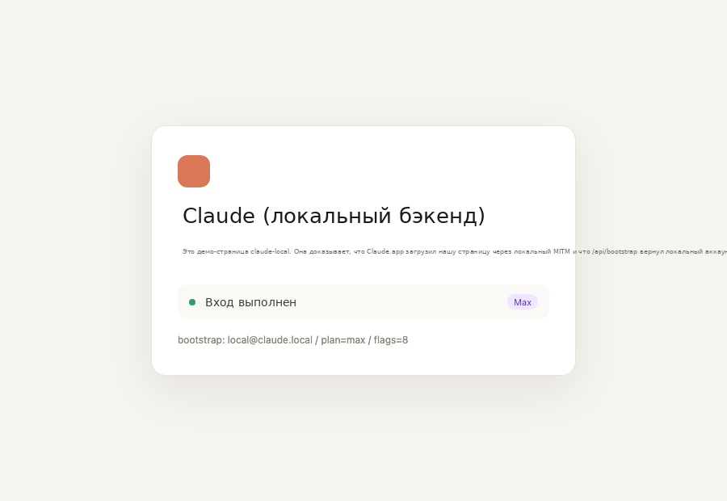
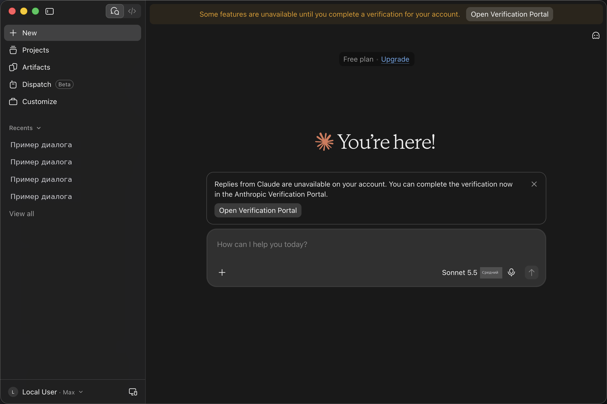

# claude-local: локальный сервер совместимости для Claude Desktop (PoC)

**[English](README.md) · [简体中文](README.zh-CN.md) · [Русский](README.ru.md)**

## Управляемый режим Codex++

Управляемый режим использует оригинальный Claude Desktop, подключённый к локальному
сервису через `--proxy-server`; установщик Claude не пересобирается и не переписывается.
Прокси, сертификаты, кеш и данные сессий Codex++ держит в отдельном каталоге состояния;
при обычном запуске оригинала это прокси-подключение само не появляется.

`CLAUDE_LOCAL_MANAGED=1` включает управляемый протокол. Во время работы нужны только
версионированные Node-модули и китайский словарь локализации; каталоги `mock/`, записанные
на этой машине bootstrap-файлы, записи словарей и `vendor/` из репозитория не читаются.
Статика веб-страниц по-прежнему отдаётся оригинальным клиентом и доступным апстримом;
синтетические данные API не содержат приватных значений доступа динамических ресурсов.
Управляемый режим отдаёт официальный SPA только для чтения из текущего установщика; при
включённой локализации same-origin `page-shim.js` добавляется только в HTML, прошедший
через прокси, до запуска первого официального скрипта — он подводит официальный фронтенд
к китайскому словарю, не переписывая Claude.app.

| Переменная окружения | Назначение |
| --- | --- |
| `CLAUDE_LOCAL_GATEWAY_URL` / `_KEY` / `_MODEL` | Корневой адрес шлюза Codex++, локальные учётные данные и модель по умолчанию; обязательны в управляемом режиме |
| `CLAUDE_LOCAL_GATEWAY_MODELS` | JSON-массив строк со списком выбираемых ID провайдер/модель |
| `CLAUDE_LOCAL_GATEWAY_SMALL_MODEL` | Модель для лёгких задач; если не задана — используется модель по умолчанию |
| `CLAUDE_LOCAL_GATEWAY_MODEL_WINDOWS` | JSON-объект с окнами контекста по моделям (`{"provider/model": 1100000}`); ключи принимают и короткие имена моделей |
| `CLAUDE_LOCAL_GATEWAY_DEFAULT_WINDOW` | Окно, которое интерфейс/CLI показывают для выбранной модели без отдельной записи; без него действует предположение Claude о 200k |
| `CLAUDE_LOCAL_WEB_I18N_DIR` | Полный китайский словарь локализации, поставляемый с приложением |
| `CLAUDE_LOCAL_CACHE_DIR` | Локальный кеш прокси; сюда же пишутся патчи диктовки |
| `CLAUDE_LOCAL_STATE_FILE` | Файл сессий и настроек уведомлений; атомарная запись, права `0600` |
| `CLAUDE_LOCAL_READY_FILE` / `_INSTANCE_ID` | Квитанция готовности и идентификатор экземпляра текущего запуска |
| `CLAUDE_LOCAL_LOCALIZATION` / `_VOICE_INPUT` / `_COMPUTER_USE` / `_BACKGROUND_MODE` / `_FORCE_BACKGROUND_MODE` | Независимые переключатели возможностей: `0` — выкл, `1` — вкл; последний игнорирует потолок версии macOS для фонового режима |
| `CLAUDE_LOCAL_BUILTIN_EXTENSIONS_DIR` / `_EXTENSIONS_DIR` / `_EXTENSIONS_STATE` | Расширения страниц: каталоги встроенных и пользовательских расширений (`<id>/manifest.json`) и файл состояния, где записано, что включено (`{"enabled":[...]}`). Включённые расширения по их манифесту вставляются в оболочку страницы до официальных скриптов как `/__codex_plus/ext/<id>/<file>` и читаются с диска при каждом запросе |
| `CLAUDE_LOCAL_PAGE_PLAN` / `_PAGE_STATUS` | Пакеты расширений Codex++ (`<id>/codexpp.json`): план инъекций, который пишет хост-программа (`page-plan.json`; принимается только файл, читаемый одним владельцем), и файл, куда страница отчитывается о результатах загрузки каждого пакета. См. ниже «Пакеты расширений и страничный API» |
| `CLAUDE_LOCAL_EXT_HOST_RECEIPT` | Файл учётных данных внешнего хоста (`{"port", "token"}`). Если задан, бэкенд расширений локально не поднимается, а вызовы бэкенда со страницы переходят ему; Codex++ использует это, чтобы страница и сессии Code работали с одним экземпляром бэкенда |
| `CLAUDE_LOCAL_COWORK` | Главный переключатель Cowork (GrowthBook `yukon_silver`), по умолчанию включён; при `0` берётся значение самого Claude из записанного шаблона |
| `CLAUDE_LOCAL_COWORK_PROMPT_FILE` | Файл, переопределяющий системный промпт Cowork; если не задан, промпт читается из локального `app.asar`, а если и там его нет — используется встроенный запасной текст |
| `CLAUDE_LOCAL_TEMPLATE` | Какая записанная версия используется в записанном интерфейсе (имя каталога `mock/<build>/`, то есть build id фронта); если не задана или версия снята с обслуживания — самая свежая (по `data-build-timestamp` оболочки страницы) |
| `CLAUDE_LOCAL_HUB_HOME` | Принимается только `1`: использовать объединённую главную страницу Claude (GrowthBook `claude_ai_hub_web_delivery`, чаты и Cowork в одном поле ввода). Если не задана — классическая главная страница с переключателем «Чаты \| Cowork»: флаг выключается, а его код убирается из `gated_imports`. Настройка «Объединённая главная страница» по умолчанию включена, при запуске локального сервиса передаётся `1` |

Управляемый запуск поддерживает `--port 0`: после привязки порта пишется квитанция
`{instanceId,pid,port,mode,lastClientAt}` — без учётных данных шлюза.
`GET /__codex_claude_local/health` возвращает тот же идентификатор и время последнего
подключения клиента; сам опрос здоровья это время не обновляет. Прямые HTTP-запросы к
модели требуют локальных учётных данных шлюза и отклоняют запросы с браузерным `Origin`;
HTTPS-цепочка оригинального клиента по-прежнему обслуживается локальным сервисом.

Синтетическая конфигурация селектора моделей строится из списка доступных моделей; RPC
`SendMessage.model` и `SetConversationModel` сохраняют фактический выбор; многоходовые
диалоги отправляют шлюзу и накопленную историю. Неизвестная нативная модель по умолчанию
заменяется настроенной; фиксированная лёгкая модель Haiku — лёгкой конфигурацией. После
рестарта прокси сессии и настройки уведомлений восстанавливаются, прерванные ответы
помечаются завершёнными — автоматически ничего не пересылается. По EOF стандартного ввода
или `SIGTERM` управляемый процесс сохраняет состояние и закрывает слушатель.

Контрактные тесты управляемого режима:

```bash
node --test tools/claude-local/managed.test.mjs
```

Цель: **без аккаунта, модель идёт через ваш API, но клиент полностью функционален.**

Способ — не подделка сессии, а **роль сервера на себя**:

```
Claude.app ──► локальный CA + MITM(8899) ──► статика проходит насквозь к claude.ai (настоящий UI)
                                        ├─ /api/*, /edge-api/* перехватывают локальные моки
                                        └─ /claudeai-rpc/* ConversationService
                                             └─ PerformAction(send_message) → запись диалога
                                                StreamTimeline → кадры update/append
                                                └─ текст ответа ← SSE локального шлюза моделей
```



> На картинке выше Chromium (тот же движок, что у Electron) открывает `https://claude.ai/`
> через локальный прокси: CONNECT → терминация TLS → `/api/bootstrap` возвращает локальный
> аккаунт → страница показывает «Выполнен вход · Max».

## Текущее состояние (проверено на практике)

| Возможность | Статус | Как проверено |
| --- | --- | --- |
| Локальный CA + серверный сертификат | ✅ | `scripts/gen-ca.sh` |
| CONNECT + терминация TLS (SNI) | ✅ | `scripts/test.sh` |
| Фейковый аккаунт `/api/bootstrap` (plan=max) | ✅ | `curl --proxy + --cacert` возвращает JSON |
| `/api/organizations`, список/создание диалогов | ✅ | там же |
| Настоящий Claude.app показывает Local User · Max | ✅ | живой UI + `demo/ru/app-loggedin.png` |
| `PerformAction` send_message → MutationAck | ✅ | проверено: без ретраев, сообщение появляется |
| `StreamTimeline` update→append→complete | ✅ | проверено: стриминг-рендер (markdown) |
| Ответы подключены к локальному шлюзу (Anthropic Messages SSE) | ✅ | magpie @127.0.0.1:3425 |
| Новый диалог / вопрос в старом | ✅ | оба пути проверены |
| Демо-страница (проверяет, что Claude грузит нашу страницу) | ✅ | `/` отдаёт демо |
| Установка CA в Связку ключей | ⚠️ один ручной клик разрешения | `scripts/install-ca.sh` |

### С этой сети claude.ai недоступен

```
напрямую claude.ai            → 302 /app-unavailable-in-region (региональная блокировка)
через Clash(7897) claude.ai    → 403 Cloudflare challenge
настоящий Chrome на claude.ai  → страница Cloudflare с проверкой на человека
```

Поэтому в `mock`-режиме настоящие ресурсы фронта не получить (у самого Claude на этой
машине то же состояние). **На машине, где claude.ai открывается нормально, достаточно
запустить `--mode mock` — и получится «настоящий UI + локальный аккаунт».**

## Быстрый старт

```bash
cd tools/claude-local

# 1) сгенерировать локальный CA
sh scripts/gen-ca.sh

# 2) установить в Связку ключей (одно системное окно — нажмите «Разрешить»)
sh scripts/install-ca.sh

# 3) самопроверка (Claude не нужен, интернет тоже)
sh scripts/test.sh

# 4) запустить демо: Claude загрузит локальную демо-страницу и покажет Max
sh scripts/run.sh demo

# 5) в сети с доступом к claude.ai — настоящий UI + мок /api
sh scripts/run.sh mock
```

Параметр запуска Claude: `--proxy-server=http://127.0.0.1:8899`.

## Каталоги

```
ca/                 локальный CA и серверные сертификаты (не коммитить)
mock/bootstrap.json записанный на этой машине шаблон аккаунта (не коммитить; может содержать учётные данные ресурсов)
mock/api/conversations.json  записанный шаблон истории (не коммитить)
demo/index.html     демо-страница (доказывает работоспособность цепочки)
proxy.mjs           CONNECT + TLS + mock + проброс к апстриму + маршрутизация
rpc.mjs             protobuf wire / кадры Connect / конструкторы сообщений
conversation-service.mjs  ConversationService: StreamTimeline / PerformAction / запасные ветки
scripts/gen-ca.sh   генерация сертификатов
scripts/install-ca.sh / uninstall-ca.sh
scripts/run.sh      поднять прокси + запустить Claude
scripts/test.sh     сквозная самопроверка
.cache/             кейш статики апстрима (пишется в режиме passthrough)
```

При старте в mock-режиме клиент диктовки фиксированной версии читается из локального
Electron-кеша Claude, и база ожидания drain обычной диктовки в локальной копии
 продлевается до 125 секунд; ветка `thinkAloud` остаётся на 60 секундах. Патч пишет только
в `.cache/` этого каталога и не трогает кейш приложения Claude; при несовпадении версии
запуск останавливается. Восстановить локальную копию:

```bash
node scripts/patch-dictation-drain.mjs --restore
node scripts/patch-dictation-start.mjs --restore
```

Патч старта диктовки той же фиксированной версии ограничивает загрузку динамических
модулей 15 секундами, нативный старт — 20, `AudioContext.resume()` — 5. По таймауту текущий
старт отменяется и аудиоконтекст освобождается; опоздавший поток микрофона освобождается
проверкой нативного generation, интерфейс возвращается в состояние повторной попытки. Патч
отдаётся только локальным прокси в mock-режиме; установщик и системные права на микрофон
не меняются. `[Claude Local Dictation]` и `window.__codexPlusLocalDictationStatus` в
консоли разработчика пишут только стадии pending / connecting / recording / finishing /
idle / error и булевы статусы — без расшифровок, аудио и идентификаторов сессий.

Локальная WebSocket-диктовка запускает одно настоящее промежуточное распознавание после
накопления 4 секунд аудио в текущем сегменте с речью и обновляет его каждые следующие
4 секунды непрерывной речи; текст сегмента отправляется по паузе в 600 мс или при
достижении сегментом 12 секунд. `CloseStream` дочитывает принятое аудио; чистая тишина
не запускает распознавание и не создаёт текст. Потолок одной WebSocket-сессии — 16 минут
или суммарно 25 МиБ аудио, срабатывает первое.

Базовый таймаут запроса общего HTTP-интерфейса расшифровки остаётся 120 секундами; это не
значит, что WebSocket-диктовка ждёт конца записи для распознавания. Истечение HTTP-запроса
само возвращает ошибку; ожидание drain на клиенте не продлевает и не повторяет этот
запрос. Запуск в mock-режиме использует `--disable-http-cache`, чтобы клиент читал эту
копию у локального прокси; в passthrough и демо патч не применяется. Скрипты запуска
выравнивают `CODEX_PLUS_STATE_DIR` с текущим экземпляром менеджера: явная переменная
окружения важнее, затем `dist/local-build/state`, соответствующий репозиторному
`dist/local-build/Codex++.app`, и в конце откат на `$HOME/.codex-session-delete`.

В исходниках нет записанных на этой машине аккаунтов, шаблонов сессий и статического
кеша; без записей прокси использует встроенные заглушки. Проверка настоящего UI в этом
документе опирается на локальные записи; полная совместимость UI по-прежнему зависит от
локальных данных API и статики.

## Какие эндпоинты замоканы

```
GET  /api/bootstrap
GET  /api/bootstrap/:org/system_prompts   (системный промпт Cowork; сначала читается из локального app.asar)
GET  /api/account
GET  /api/organizations
GET  /api/organizations/:org
GET/POST /api/organizations/:org/chat_conversations
GET  /api/organizations/:org/chat_conversations_v2   (статический шаблон + слияние runtime-диалогов)
GET  /api/organizations/:org/chat_conversations/:uuid
POST /api/organizations/:org/chat_conversations/:uuid/completion   (SSE, старый путь, десктопом уже не используется)
GET  .../usage | /limits
POST /claudeai-rpc/anthropic.bard.api.v1alpha.ConversationService/*  (Connect RPC, главный путь)
```

Значения полей — заглушки, повторяющие форму публичного кода фронта. **На машине с
доступом к claude.ai сначала прогоните `--mode passthrough` и снимите настоящие
ответы**, затем выравнивайте поле за полем (тот же приём, каким калибровали стабы Codex
через `capture-account.mjs`).

## Откат

```bash
sh scripts/uninstall-ca.sh   # удалить CA
# выйти из Claude и открыть обычным способом (без --proxy-server)
```

## Границы

- Никакой подделки аккаунта: личность Claude живёт на сервере, в клиенте нет опоры для подделки.
- Claude.app не трогается: только установка CA + флаг прокси; обновления работают как раньше.
- `/completion` требует превращать вывод сторонней модели в последовательность SSE-событий
  claude.ai (скелет заложен, подключение шлюза — следующий шаг).
- Полнота функций зависит от покрытия моков; Computer Use требует проверки протокола
  «фронтенд + локальный мост» и пока не покрыт.

## Дальнейшие шаги

1. Персистентность диалогов: CONV_STATE на диск (JSON), история переживает рестарт;
2. Мультимодальность/вызовы инструментов: схемы attachments, client_tools, elicitation уже
   в дескрипторе — добавить по мере надобности;
3. Контекст на стороне шлюза: сейчас в каждом ходе уходит только последний промпт; позже
   собирать messages-историю из conv.turns;
4. Отдельно проверить цепочку Computer Use / Cowork.

---

## Поправка от 2026-11-07 по итогам живого теста (важно)

После запуска локального Claude 4.16336.0 с `--proxy-server` фактически наблюдалось:

- окно — по-прежнему **локально рендеримый** интерфейс Cowork / Code; запроса `GET /` нет;
- до прокси доходят только эндпоинты вроде `POST /api/event_logging/v2/batch` и
  `POST /api/v2/rum`;
- то есть: **главный UI этой сборки десктопа Claude — не веб-страница claude.ai**;
  claude.ai обслуживает лишь часть API и телеметрию.

Скорректированные выводы:

| Прежнее предположение | Измерено |
| --- | --- |
| Главный UI десктопа = удалённая страница claude.ai | ❌ локальный рендер |
| Чтобы работало, нужно отзеркалить настоящий UI | ❌ не нужно |
| Фейковый `/api/bootstrap` заставит UI показать Max | ❌ локальный UI не берёт аккаунт из bootstrap |

Поэтому ценность инструмента сужается до:

- ✅ доказательства работоспособности связки «локальный CA + MITM + фейковые API»
  (проверено);
- ✅ прямого переиспользования, если когда-нибудь понадобится веб-поверхность claude.ai;
- ❌ разблокировки решаемых на сервере аккаунтозависимых функций локального UI
  (Computer Use, Cowork и т.п.) — это за пределами возможного.

Аккаунт-состояние локального UI определяется хранилищем самого приложения
(`~/Library/Application Support/Claude-3p/`) и серверными API — не HTML claude.ai.

---

## Веха 2026-11-07: настоящий Claude.app «поверил», что вошёл в аккаунт



Конфигурация:

- `~/Library/Application Support/Claude-3p/claude_desktop_config.json` → `deploymentMode: "1p"`
- убрать `configLibrary/` (иначе приложение уйдёт в онбординг шлюза)
- запуск: `open -a Claude --args --proxy-server=http://127.0.0.1:8899`
- прокси: `node proxy.mjs --mode mock`

Результат: настоящий десктоп Claude отрисовывает полный интерфейс чата, внизу слева
показывает **Local User · Max**, появляются Projects / Artifacts / Dispatch / Customize.

Источники данных:

- оболочка HTML: записана из настоящего браузера скриптом `capture.mjs`
- структура аккаунта: после входа в настоящий аккаунт снят `/edge-api/bootstrap` и
  обезличен в `mock/bootstrap.json`
- формы эндпоинтов: `mock/api/*.json` (conversations / account_profile / skills /
  experiences и др.)

### Возврат режима шлюза

```bash
cd ~/Library/Application\ Support/Claude-3p
python3 - <<'PY'
import json; p='claude_desktop_config.json'; d=json.load(open(p)); d['deploymentMode']='3p'; json.dump(d,open(p,'w'),ensure_ascii=False,indent=2)
PY
mv /tmp/claude-configLibrary-live2 configLibrary   # если вы его убирали
```

---

## Ответы чата: Connect + protobuf (работает)

Измерено: ответы клиент шлёт не через JSON `/completion`, а через Connect RPC поверх
HTTP/1.1 chunked:

```
POST /claudeai-rpc/anthropic.bard.api.v1alpha.ConversationService/<Method>
Content-Type: application/connect+proto   (server-streaming)
Content-Type: application/proto           (unary)
```

Формат кадра: `[1 байт flag][4 байта длины big-endian][protobuf]`; flag 0x02 = конечный
кадр (полезная нагрузка — JSON-трейлеры).

Реализация в два слоя:

- `rpc.mjs` — самописный protobuf-wire кодек (без внешних зависимостей) + кадры Connect +
  все используемые конструкторы сообщений
- `conversation-service.mjs` — диспетчер `ConversationService`: `StreamTimeline`
  (долгоживущее соединение), `PerformAction` (send_message / stop_generation),
  `SendAndSettle`, `ReadConversation`, `ListConversations`, `StreamConversationList`,
  `GetNewConversationDefaults` и другие запасные ветки

### Конвейер ответов

```
PerformAction(send_message)                StreamTimeline (долгоживущее)
  ├─ разбор ActionHeader.mutation_id         ├─ первый кадр: ConversationUpdate (running, полный снапшот)
  ├─ разбор SendMessage{message_id,          ├─ кадры ContentBlockAppend × N (по дельте SSE шлюза)
  │    assistant_message_id, text, ...}      └─ хвостовой кадр: ConversationUpdate (complete + TurnDisposition=FINISHED)
  ├─ recordSend → conv.turns[] (идемпотентно, дедупликация по humanId)
  ├─ ensureReply → anthropicStream(prompt) → SSE шлюза /v1/messages
  └─ PerformActionResponse{ack=1: MutationAck{high_water_mark, applied}}
```

### Грабли, на которые наступили (проверено живьём)

- `PerformActionResponse.ack` — это **поле 1**, а не 4 (4 — corbel_edit_accepted).
  Ошибочное поле — клиент не видит ack → очередь мутаций повторяет отправку (один и тот же
  send_message уходил 6 раз).
- Серверный сертификат должен быть выпущен `ca.pem`, и subject ≠ issuer (совпадающие
  имена отвергаются как self-signed).
- `recordSend` обязан быть идемпотентным по `message_id`, иначе ретраи клиента порождают
  дубликаты ходов.
- `ContentBlockAppend` несёт только `text_delta`; полный текст страховочно приходит в
  `ContentBlock.text` финального `ConversationUpdate` (клиент сливает оба).
- **Списочные эндпоинты не могут отвечать `{}`**: клиентский `flatMap(p => p.items)`
  выдаёт элементы `[undefined]` → при рендере `Cannot read properties of undefined
  (reading 'skill')` → fatal boundary ("This page ran into a problem" 0NV6PUA).
  Пагинированным эндпоинтам нужна своя пустая структура, например
  `{items:[],data:[],next_cursor:null,has_more:false}`.
  `/oauth_tokens` требует массив верхнего уровня; `/cowork_plugin_metadata` — словарь
  объектов; пагинированная форма не годится;
  см. поправку 2026-11-08 и регрессионную проверку ниже.
- `/i18n/*.json` с апстрима 302 на HTML → клиент падает на разборе; заменено полным
  локальным словарём, короткие ID `/s/` и `dynamic`-словарь обрабатываются отдельно
  (см. поправку 2026-11-08 ниже).
- **`activeOrganization` решает показ тарифа**: если в bootstrap он null — интерфейс
  показывает "Free plan", все модели Pro/Max заперты за "Upgrade", вкладка Code пишет
  "isn't included in your plan". Нужно выставлять копию org (включая
  `rate_limit_tier`/`billing_type`/`subscription_management`).
- `org.capabilities=["chat"]` выключает входы Code/Cowork; добавить `claude_code`,
  `cowork`, `artifacts`, `projects`, `computer_use`, `connectors`.

### Конфигурация шлюза (переменные окружения)

```
CLAUDE_LOCAL_GATEWAY_URL   по умолчанию http://127.0.0.1:3425   (magpie: совместим с Anthropic Messages)
CLAUDE_LOCAL_GATEWAY_MODEL по умолчанию claude-sonnet-4-6
CLAUDE_LOCAL_GATEWAY_KEY   по умолчанию magpie                  (x-api-key / Bearer)
CLAUDE_LOCAL_DEBUG=1       печатать поля запроса PerformAction (отладка)
```

Состояние диалогов живёт в памяти (`CONV_STATE`) и очищается рестартом прокси — для PoC
допустимо; `/api/*/chat_conversations_v2` вливает runtime-диалоги в статический шаблон.

## Разрешение организации / коренная причина Join-потока (исправлено)

При старте клиент Claude разрешает текущую организацию через `Mo()` (бандл
`shared-l-p-m-w-4`): `preferredOrgUuid → existingOrgCookie → Zu()`. `existingOrgCookie`
читает cookie `lastActiveOrg` (имя cookie, зависящее от поверхности, возвращает
`M_(applicationType)`).

Если uuid организации в cookie не совпадает ни с одним uuid из bootstrap-членств, ответ
`/api/bootstrap/<uuid>/app_start` не находит пары → `activeOrganization` пуст →
маршрутный страж редиректит на `/org-discovery` → "Join your team" → join → "Sent to
admin".

Фильтры членств (бандл `shared-l-p-m-w-1`):

- `Ivo`: `organization.visibility_status` ∈ {active, pending, null}
- `Oi`: `capabilities` организации должны содержать `iS(applicationType)`; claude-dot →
  `"chat"`
- `Jl`: десктопный UA идёт по `preferNonHybrid` и отфильтровывает организации с
  `taint:hybrid_3p`

Лечение: удалить cookie `lastActiveOrg` домена `.claude.ai` из
`Application Support/Claude/Cookies`, устаревшие ключи области org в
`claude_desktop_config.json` и журналы leveldb Local/Session Storage.

## Цепочка режима Code (проложена)

- Cookie `lastActiveOrg` (M_() возвращает имя cookie по поверхности) со старым uuid
  организации → Mo() не разрешает организацию → join-поток /org-discovery. Достаточно
  удалить.
- Обмен OAuth-билетов: `GET/POST {apiHost}/v1/oauth/{org}/authorize` +
  `POST /v1/oauth/token`; cookie sessionKey обязана иметь `Secure` (иначе вердикт
  "lacks httpOnly or Secure"). POST-тело authorize содержит redirect_uri/state; ответ
  возвращает `{redirect_uri: "<rt>?code=...&state=..."}`.
- `downloads.claude.ai` закрыт по региону → проверенная установка той же версии
  копируется из другого профиля (например,
  `Claude-3p/claude-code/<ver>/<первые 12 символов bundle.checksum>/`); пока
  bundle.checksum совпадает с манифестом внутри app.asar, проверка проходит.
- Десктопный CLI шлёт дополнительное поле `diagnostics`; шлюзы апстрима со строгой схемой
  (ccbobi и др.) отвечают 400. Порт 8899 прокси принимает и обычный HTTP, снимает
  diagnostics/metadata.diagnostics и передаёт в magpie; достаточно направить
  `ANTHROPIC_BASE_URL` на 8899. settings.json копится в .bak-claude-local.
- Управляемые настройки: `GET /api/claude_code/settings` →
  `{uuid,settings:{},checksum:"local-1"}` + ETag;
  `policy_limits` → `{restrictions:{},compliance_taints:[],defaults:{},artifact_create_notice:null}`
  (валидатор policy-limits в app.asar требует, чтобы `restrictions` был объектом, не равным `null`,
  а не массивом). Мокать нужно оба пути — claude.ai и прямое подключение к 8899.
- `count_tokens` считается локально; `/v1/models` замокан; `/v1/messages` уходит в
  локальный шлюз.

## 2026-11-08: причина и проверка предупреждения управляемых настроек Code

`Remote managed settings failed to load (server response could not be parsed)` исходит от
встроенного Claude Code 2.1.317, а не от собственного загрузчика настроек десктопа.
Валидация ответа в CLI требует `{uuid:string, checksum:string, settings:record}`; в
прежнем моке не хватало `uuid`. Десктоп читает только `settings`, поэтому пока он писал в
журнал `fetched (0 keys)`, CLI всё равно падал на разборе. Все три пути — HTTP, claude.ai
и api.anthropic.com — теперь возвращают стабильный локальный `uuid`, сохраняя
`content.entries`, нужный остальным эндпоинтам десктопа.

Результаты проверки:

- на настоящем бинарнике CLI: старый ответ даёт `path:["uuid"]`, `parse_error` и то самое
  предупреждение;
  после добавления только `uuid` — `Remote settings: Fetched successfully`, предупреждение
  исчезло;
- новая сессия Code в Claude.app получает «Соединение в норме.» без предупреждения об
  управляемых настройках;
- глобальный `HTTPS_PROXY` не менялся, проверка TLS не отключалась.

Заодно исправлен префикс-матч `/v1/messages`: раньше он перехватывал
`/v1/messages/count_tokens`, и локальная ветка подсчёта была недостижима.

Регрессионные тесты (сначала сгенерируйте локальный CA; все тестовые запросы обслуживаются
локально):

```bash
node --test tools/claude-local/proxy.test.mjs
```

Покрывают контракт CLI по всем трём путям настроек, настоящую проверку CONNECT/TLS,
совместимость `content.entries` десктопа, список авторизованных экземпляров, словарь
метаданных плагинов, локальный подсчёт токенов и вычистку diagnostics из сообщений.

### Краш страницы настроек Code `1OFIM25`

`(n ?? Ra).filter is not a function` из стека идёт от списка авторизованных экземпляров
на странице настроек. Клиент вызывает `filter` прямо на ответе
`GET /api/oauth/organizations/:org/oauth_tokens`, поэтому пустой результат обязан быть
массивом верхнего уровня `[]` — универсальный `{}` или `{data:[]}` не годятся. Добавлен
точный GET-маршрут; после перезагрузки исходной страницы `#settings/claude-code` в
настоящем Claude.app корректно показываются и полные настройки, и пустое состояние "No
connected Claude Code instances".

Ещё одна измеренная ZodError — от `/cowork_plugin_metadata`: эндпоинт требует словарь
объектов с ключами-ID плагинов, пустой результат — `{}`, а не пагинированная структура.
Исправлено и подтверждено валидатором настоящего клиента.

### Выбран китайский, но основной интерфейс остаётся английским

Настройка языка и bootstrap уже были `zh-Hans`; проблема была в словаре:
`/i18n/s/zh-Hans.json` откатывался к 825 записям словаря десктопной оболочки из app.asar,
чьи короткие ID не совпадали с основным UI. Теперь используется полный словарь из
`assets/claude-localization/catalogs/` репозитория, поверх — локальные записи и локальные
переопределения; для `/s/` единственному 10-символьному ID добавлены 6-символьные
псевдонимы по правилам клиента, длинные ID и существующие короткие сохранены. `/dynamic/`
читает динамический словарь отдельно и больше не подмешивает записи оболочки.

После перезагрузки настоящего Claude.app боковая панель, тулбар Code, поле ввода и
страница настроек показывают китайский. Названия брендов и строки, ещё не покрытые
словарём, могут остаться в оригинале.

### Подсказка о верификации личности для локального аккаунта

Получая пустой объект от `/api/organizations/:org/kyc_status`, страница настроек считает
верификацию незавершённой. Локальный мок теперь явно возвращает
`{status:"not_required",should_poll:false}`, и нативный компонент прячет подсказку.
Меняется только локальный мок-эндпоинт; удостоверения не отправляются, состояние
верификации настоящего аккаунта не трогается.

### Краши страниц «Основные», «Аккаунт», «Выставление счетов» и Artifacts

Журналы настоящего клиента указывают на следующие контракты ответов — единой страховки
`{}` быть не может:

| Страница | Эндпоинт | Обязательная структура |
| --- | --- | --- |
| Основные | `/api/organizations/:org/notification/preferences` | `preferences.feature_preference`, `effective_preferences`, `push_reachability` |
| Аккаунт | `/api/account/deletion-allowed` | `deletable:false,reasons:[],display_message:null` |
| Аккаунт | `/api/auth/trusted_devices` | `devices:[]` |
| Аккаунт | `/api/auth/mfa` | `mfa_enrolled:false,methods:[]` |
| Аккаунт | `/api/auth/sessions/list-active` | `data:[],pagination:{has_more:false,total:0}` |
| Счета | `/api/stripe/:org/invoices` | `invoices:[],next_page:null` |
| Artifacts | `/api/organizations/:org/user_artifacts` | `artifacts:[]` |
| Artifacts | `/api/organizations/:org/user_artifacts/count` | `count:0` |
| Artifacts | `/api/frame/frames`, `/api/frame/frames/external` | `frames:[]` |

Предпочтения уведомлений поддерживают GET/PATCH, изолированы по организациям и сливаются
по функциям и каналам с сохранением явно выключенных `false`. Хранятся только в памяти
процесса прокси — сбрасываются рестартом; реальные уведомления не подписываются. Удаление
аккаунта остаётся закрытым; MFA отдаёт только GET-статус локального мок-аккаунта и не
меняет двухфакторную настройку настоящего. Регрессионные тесты покрывают настоящие
запросы CONNECT/TLS, одновременные первые обновления, некорректный ввод и имена свойств
прототипа.

### Нативный вход в управление компьютером

`/api/desktop/features` нативного десктопа ожидает уже вычисленный объект `features`
GrowthBook. Простые булевы флаги дают `response body has no valid features object`, после
чего управление компьютером помечается `not_enabled`. Локальный мок даёт только
`1291166712` (chicago_config) со значениями
`value:{enabled:true,appScopedEnabled:true},on:true,off:false,source:"force"` — прочие
экспериментальные функции не включаются.

Этот ответ касается цепочки 1p-десктопа локального прокси; настоящий режим 3p этот
удалённый флаг отфильтрует. Клиент по-прежнему проверяет платформу, комплаенс-ограничения,
пользовательскую настройку `chicagoEnabled` и настоящие права macOS на универсальный
доступ и запись экрана. Режим развёртывания, системные права и бинарник клиента не
меняются, выданные права не имитируются. Доступный вход не означает, что настройка прав
или сквозное исполнение инструментов проверены.

Оффлайн-сверка с оригинальным разбором, Zod-валидацией и функциями rollout текущего
клиента: старый ответ — `parse-error`; новый — `success` с открытым rollout; при
`chicagoEnabled=false` фактическое исполнение всё равно не включается. Строка
`enabled:"true"` по-прежнему отвергается, просроченный конфиг по-прежнему не действует.

Фоновый режим дополнительно читает `appScopedEnabled` из того же конфига — при одном
`enabled:true` всё ещё показывается «Фоновый режим не включён для вашего аккаунта». После
дополнения нативный `computerUseAppScoped` проходит проверку; фактическим фоновым
инструментом управляет это же поле; проверки клиентом версии системы и срока действия
конфига остаются. Пользовательский `chicagoPreferredMode` не меняется — выбранный сейчас
«фон / полный контроль» остаётся решением пользователя. После обновления настоящего
Claude.app пункт фона из недоступного стал выбираемым, показан выбранным «фон»;
универсальный доступ и запись экрана по-прежнему отображаются выданными. Фактическая
фоновая операция через эту проверку не выполнялась.

## Записанные версии (mock-templates/)

Данные записанного интерфейса лежат в отдельных каталогах по версиям фронта: в
`mock-templates/<build>/` — обезличенные `bootstrap.json`, `api/*.json` и оболочка страницы
`shell.html` из той же записи. Имя каталога обязано совпадать с build id фронта (тесты это
проверяют). `build.rs` встраивает каждый каталог в программу и устанавливает их в
`<state>/claude-local/mock/<build>/`; пользователь выбирает версию в
Настройки → Интерфейс → Версия, по умолчанию самая свежая. Код фронта (JS/CSS и т.п.) не
упаковывается: когда он нужен, локальный сервис скачивает его с
`assets-proxy.anthropic.com` и кеширует.

Добавить новую версию (нужен аккаунт, который может войти в claude.ai; одной записи хватит
всем пользователям):

1. `open -na "Google Chrome" --args --user-data-dir=<временный каталог> --remote-debugging-port=9447 https://claude.ai/login`, войти.
2. `node scripts/record-template.mjs --cdp http://127.0.0.1:9447 --out <приватный каталог>`
3. `node sanitize-mock.mjs <приватный каталог>/mock` → пишется в `mock-templates/<build>/`
4. Проверить, что не осталось личных данных (`cargo test -p claude-local embedded_mock_template_is_sanitized`
   проверяет почту; uuid аккаунта и названия организаций сверите вручную), проверить в деле и
   закоммитить. Каталог записи и временный профиль Chrome по окончании удалить.

Старые версии остаются; слишком старые или нерабочие — просто удалить каталог.

## Пакеты расширений и страничный API

Помимо расширений страниц (`manifest.json`), в `extensions/` можно класть пакеты расширений
Codex++ (`codexpp.json`). Если в папке есть `codexpp.json`, она считается пакетом расширений, и
инъекция старого формата её пропускает. Часть пакета, живущая на странице Claude, описана в блоке
`claudeDesktop` манифеста:

| Поле | Значение |
| --- | --- |
| `claudeDesktop.renderer` | Скрипты, внедряемые в страницу (`.js`, строка или массив); склеиваются по порядку и выполняются в одной области видимости |
| `claudeDesktop.styles` | Стили (массив `.css`) |
| `claudeDesktop.methods` | Методы бэкенда, которые может вызывать страница; бэкенд — это `backend.script` из манифеста |

Правила манифеста живут только в Rust (`src/extensions/codexpp.rs`), локальный сервис манифесты
не разбирает: хост-программа превращает включённые пакеты в план инъекций
(`src/extensions/plan.rs`), а локальный сервис только читает файлы и склеивает их.

### Что появляется на странице

- `/__codex_plus/rt/runtime.js`: страничный рантайм (`page-runtime.js`), предоставляет
  `window.codexPlus` с именами членов, как в интерфейсе Codex++ (контракт — `page-api.json`).
  `codexPlus.host` равен `"claudeDesktop"`, а `codexPlus.supports(имя)` отвечает, доступна ли
  здесь конкретная точка крепления.
- `/__codex_plus/pkg/<slug>.js`: по одному скрипту на пакет расширений, обёрнутому `page-wrap.js`.
  Синтаксическая ошибка или исключение в одном пакете сказывается только на нём.
- Оба вставляются с `defer` до официальных скриптов и отвечают только на same-origin-запросы
  (`Sec-Fetch-Site: same-origin`).

### Точки крепления

Элементы интерфейса, которые регистрирует расширение, рантайм отрисовывает на странице Claude.
Не зависящие от DOM Claude (уведомления, диалоги подтверждения, целые страницы, плавающие вкладки,
горячие клавиши, темы, слот `overlay`) работают на любой странице; остальные цепляются к
собственному DOM Claude, а позиции перечислены в таблице якорей `page-anchors.js`:

| API | Где крепится |
| --- | --- |
| `registerPage` / `registerNavEntry` | После группы строк навигации «Проекты / Artifacts / Плагины» в боковой панели; если не найдено — откат к плавающей кнопке в правом нижнем углу |
| `registerComposerAction` | Слева в панели инструментов поля ввода, рядом с плюсом |
| `registerCommand` / `registerInputTrigger` | Поле ввода: по Enter перехватывается «/имя аргументы»; кандидаты всплывают, когда перед курсором стоит символ-триггер |
| `registerMessageAction` / `registerMessageDecoration` | В строке действий каждого сообщения (перед меткой времени); между телом ответа и строкой действий, под пузырём сообщения пользователя |
| `registerSlot` | `composer.above` / `composer.below`, `thread.top` / `thread.bottom`, `turn.after`, `sidebar.top` / `sidebar.bottom`, `titlebar`, `sessionRow.suffix`, `overlay` |
| `registerRowAction` | Рядом с «Ещё параметры» в каждой строке списка недавних диалогов |
| `registerSidePanel` | Переключатель — в группе кнопок в шапке страницы диалога; панель закреплена справа, а основная область уступает ей ширину |
| `registerMenuItem` / `registerSettingsSection` / `registerSettingsPanel` | Собственная страница рантайма «Расширения» (когда что-то зарегистрировано, в боковой панели появляется вход) |

Кнопки и строки боковой панели — это клоны соседних родных элементов с заменёнными значком и
текстом, поэтому их вид следует за Claude. Для каждого хоста считается отпечаток по тому, «что
зарегистрировано», и пока он не меняется, DOM не трогается; вставленные самим рантаймом узлы несут
`data-codex-plus-claude`, контейнеры, отданные расширению для отрисовки, — `data-codex-plus-ext`;
при сканировании свои записи узнаются по этим двум атрибутам. Если якорь не найден, это место
просто не появляется, а вместе со `status` отчитывается «не закреплено»; остальная часть
расширения работает как обычно.

Пока без места: `registerToolView` (блок вызова инструментов не промерян), а также слоты
`registerSlot` `composer.left` / `composer.right` / `composer.model`, `home.above`,
`settings.nav`, `activity.after`, `approval`, `header.title`, `sidebar.section`,
`sessionRow.prefix`, `projectRow.suffix`. Их регистрация — не ошибка, и ничего не появляется;
`codexPlus.supports()` для них возвращает `false`.

Якоря промеряны по вкладке Chat записанного интерфейса в обеих раскладках — объединённая главная
страница (версия B) и классическая главная страница (версия A) (см. `dev/README.md`); вкладки
Cowork и Code и встроенный интерфейс ещё не промеряны, там гарантированно работает только часть,
не зависящая от DOM.

### Страница вызывает бэкенд

`POST /__codex_plus/api/v1/<op>`; тело запроса и ответ — JSON, ответ имеет вид
`{ "ok": true, "result": … }` или `{ "ok": false, "error": "…", "code": "…" }`.

| op | Тело запроса | Действие |
| --- | --- | --- |
| `call` | `{ key, method, params, timeoutMs?, instance? }` | Вызывает метод бэкенда; при первом вызове запускается процесс бэкенда |
| `events` | `{ key, since, waitMs }` | Долгий опрос событий, которые бэкенд отдаёт через `emit`; `since: "latest"` берёт текущий конец очереди |
| `stop` | `{ key, instance? }` | Отправляется при выгрузке экземпляра страницы; в Claude бэкенд не останавливается |
| `route` | `{ key, route, payload }` | Вызывает открытый маршрут: `/diagnostics/log`, `/backend/status` |
| `status` | `{ scripts, mounts }` | Страница отчитывается о результатах загрузки каждого расширения; пишется в `CLAUDE_LOCAL_PAGE_STATUS` |
| `config` | `{ key, values }` | Меняет конфигурацию со страницы; поддерживается только внешним хостом |

Запрос должен выполнять сразу все условия: главный домен Claude, `POST`,
`Content-Type: application/json`, `Sec-Fetch-Site: same-origin`, `Origin` — главный домен Claude,
заголовок `x-codex-plus-ext` равен случайному токену текущего запуска (он передаётся вместе со
скриптом рантайма). Затем запрос проверяется по плану инъекций: пакет должен быть включён, метод
должен быть в `claudeDesktop.methods`, маршрут — в `permissions.routes` манифеста. Тело запроса —
не больше 1 MiB, ответ — не больше 4 MiB, на каждое расширение одновременно не больше 16 вызовов.

Эта проверка ограничивает страницу рамками того, что расширения объявили, но это не изоляция
расширений друг от друга: официальные скрипты и скрипты расширений на странице равноправны, и
спрятать от них токен нельзя. Поэтому секретные элементы конфигурации (`secret`) на страницу не
передаются, а достаются только бэкенду.

### Бэкенд

Бэкендами управляет `ext-backend.mjs`, исполнитель — `ext-backend-runner.mjs`: один процесс Node
на пакет расширений, рабочий каталог — его каталог данных (`extension-data/<id>`), из переменных
окружения убраны собственные `CLAUDE_LOCAL_*`, `CODEX_PLUS_*`, `ANTHROPIC_*` локального сервиса.
При изменении скрипта или конфигурации бэкенд перезапускается при следующем вызове;
останавливается после 30 минут простоя, при отключении расширения или при выходе локального
сервиса. Скрипт бэкенда имеет вид `export default function create(ctx)` и возвращает таблицу
методов; у `ctx` есть `extension`, `host` (`"claudeDesktop"`), `config`, `dataDir`, `emit`,
`provide`, `service`, `log`, а также `sessionQuery`, `sessions`, `llm`, `ui`, которые в Claude
всегда сообщают об ошибке.

### Внешний хост

Если задан `CLAUDE_LOCAL_EXT_HOST_RECEIPT`, `call`, `events` и `config` после локальной проверки
переходят на `http://127.0.0.1:<port>/claude-ext/v1/<op>`: тело запроса то же, что в таблице
выше, заголовок `x-codex-plus-claude-ext` несёт токен из учётных данных, форма ответа совпадает
со страничным API. Если файл учётных данных не читается — ответ `503` с `code: "host_offline"`.
